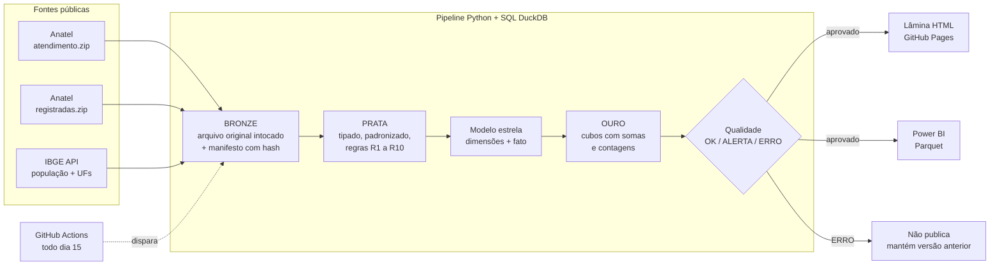

# Radar de Atendimento em Telecom

> **Onde o atendimento das operadoras está falhando, e o que melhorou ou piorou em relação ao mesmo período do ano anterior?**

Lâmina executiva construída com **dados públicos do governo** (Anatel + IBGE), com pipeline automatizado, camadas de dados, checagens de qualidade e documentação de ponta a ponta.

**🔗 Lâmina publicada:** https://lucasaccardo.github.io/radar-atendimento-consumidor/
**📊 Versão Power BI:** pasta [`powerbi/`](powerbi/)

---

## 1. O problema de negócio

Toda reclamação registrada na Anatel é, na prática, **uma falha de atendimento que escapou dos canais da operadora**: o cliente já tentou o SAC, não resolveu e foi ao regulador. Para quem opera atendimento (centrais de relacionamento, BPO, back-office), essa base mostra onde a jornada quebra.

A lâmina responde três perguntas, na ordem em que um gestor pensa:

| Pergunta | Onde a lâmina responde |
|---|---|
| **O que mudou?** Volume e qualidade subiram ou caíram em relação ao mesmo período do ano passado? | Resumo executivo, cartões de KPI e gráfico de evolução |
| **Onde dói?** Que operadora, serviço, estado e assunto concentram o problema? | Mapa por 100 mil habitantes, matriz de operadoras e assuntos |
| **Onde agir primeiro?** Qual ação tem mais impacto? | Resumo executivo (priorização por volume × excesso de reabertura) |

## 2. Indicadores (linguagem de central de atendimento)

| Indicador | Fórmula | Equivalente na operação |
|---|---|---|
| Reclamações | soma | Volume |
| Por 100 mil habitantes | reclamações ÷ população IBGE × 100.000 | Volume normalizado |
| Tempo médio de resposta | Σ dias até a resposta ÷ reclamações com tempo válido | TMR / SLA de retorno |
| Respondidas no prazo | respondidas em até 10 dias ÷ total | Nível de serviço (prazo regulatório) |
| **Taxa de reabertura** | reabertas ÷ total | **FCR invertido** (resolução no 1º contato) |
| Resolvidas | resolvidas ÷ avaliadas | Resolutividade percebida |
| Nota média | Σ notas ÷ notas válidas (1 a 5) | CSAT |

Toda comparação é **ano contra ano no mesmo período** (jan–set/2026 x jan–set/2025, por exemplo), e não contra o ano cheio.

## 3. Fontes (todas públicas, sem cadastro)

| Base | Órgão | Papel no modelo |
|---|---|---|
| [Consumidor – Indicadores de Qualidade de Atendimento](https://dados.gov.br/dados/conjuntos-dados/consumidor---indicadores-de-qualidade-de-atendimento) | Anatel | **Fato principal**: 1 linha por reclamação (resposta, reabertura, resolução, nota) |
| [Consumidor – Reclamações Registradas](https://dados.gov.br/dados/conjuntos-dados/solicitacoesregistradasnaanatel) | Anatel | Complementar: canal de entrada + conferência de volume entre fontes |
| [População residente estimada – tabela 6579](https://sidra.ibge.gov.br/tabela/6579) | IBGE | Normalização por habitante |
| [Localidades – UFs e regiões](https://servicodados.ibge.gov.br/api/docs/localidades) | IBGE | Dimensão geográfica |

> **Nota de percurso:** o projeto começou com a base do Consumidor.gov.br. Durante o desenvolvimento (12/11/2026), o servidor de arquivos do Ministério da Justiça (`dados.mj.gov.br`) saiu do DNS e a aba de dados abertos do portal parou de carregar. A fonte foi trocada pela base equivalente da Anatel, mantendo a arquitetura. O registro completo está em [`documentacao/DECISOES.md`](documentacao/DECISOES.md).

## 4. Arquitetura



| Camada | O que é | Por quê |
|---|---|---|
| **Bronze** | O `.zip` original da Anatel e o JSON do IBGE, sem alteração, + `manifesto.json` com URL, data, tamanho e hash SHA-256 | **Rastreabilidade**: qualquer número pode ser levado de volta ao arquivo de origem |
| **Prata** | Dado tipado e padronizado, com marcadores de qualidade | **Saneamento** documentado regra a regra |
| **Ouro** | Cubos agregados com **somas e contagens** (nunca médias prontas) | Qualquer filtro recalcula médias corretas, sem o erro da "média de médias" |
| **Qualidade** | 16 checagens automáticas antes de publicar | **Integridade**: com ERRO, nada é publicado |

## 5. Como rodar

Pré-requisitos: Python 3.10+ e Git.

```bash
# 1. instalar dependências (duckdb e requests)
pip install -r requirements.txt

# 2. testar tudo com dados sintéticos (sem internet, ~5 segundos)
python tests/gerar_amostra_sintetica.py
python pipeline/executar_pipeline.py --amostra

# 3. rodar com os dados reais (baixa ~460 MB da Anatel na primeira vez)
python pipeline/executar_pipeline.py
#    ou, se você já baixou os .zip pelo navegador:
python pipeline/executar_pipeline.py --pasta-local ~/Downloads

# 4. abrir a lâmina: dois cliques em docs/index.html
#    (para ver a amostra: docs/index.html?amostra)
```

## 6. Estrutura do repositório

```
radar-atendimento-consumidor/
├── pipeline/                  # Python: só o "encanamento"
│   ├── config.py              #   tudo que é configurável fica aqui
│   ├── extrair.py             #   etapa 1: download incremental + manifesto
│   ├── transformar.py         #   etapa 2: carrega bronze e executa os .sql
│   ├── qualidade.py           #   etapa 3: checagens (portão de publicação)
│   ├── exportar.py            #   etapa 4: JSON da lâmina + Parquet do Power BI
│   └── executar_pipeline.py   #   orquestrador com log e histórico
├── sql/                       # TODA a regra de negócio, em SQL
│   ├── 01_prata.sql
│   ├── 02_dimensoes.sql
│   ├── 03_fato.sql
│   └── 04_ouro.sql
├── docs/                      # a lâmina (publicada pelo GitHub Pages)
│   ├── index.html
│   └── data/                  #   gerado pelo pipeline
├── powerbi/                   # versão Power BI + dados em Parquet
├── tests/                     # gerador de amostra sintética para teste offline
├── dados_referencia/          # última resposta válida do IBGE (usada se a API não responder)
├── documentacao/              # dicionário, regras e decisões
│   └── historico/             #   catálogo da fonte original (Consumidor.gov.br)
└── .github/workflows/         # atualização automática mensal
```

## 7. Documentação

| Documento | Para quê |
|---|---|
| [Dicionário de dados](documentacao/DICIONARIO_DE_DADOS.md) | Cada coluna das fontes e do modelo |
| [Regras de saneamento](documentacao/REGRAS_DE_SANEAMENTO.md) | R1 a R11: o que cada regra faz e por quê |
| [Decisões técnicas](documentacao/DECISOES.md) | Por que cada escolha foi feita (e o que foi descartado) |

## 8. Limitações conhecidas

- **Assuntos e canal de entrada** são exibidos em visão Brasil quando há filtro de UF. A lâmina é estática (sem servidor), então os dados são pré-agregados; abrir esses cubos por UF multiplicaria o tamanho do arquivo. No Power BI, todos os cruzamentos estão disponíveis.
- **Reclamações na Anatel não são o total de contatos** das operadoras: são os casos que escalaram ao regulador. A leitura correta é "falhas que escaparam dos canais", não "volume de atendimento".
- **A API do IBGE não responde aos servidores do GitHub** (que ficam fora do Brasil). Na atualização automática, a população vem da cópia guardada em `dados_referencia/`, renovada a cada execução local. Como o IBGE publica a estimativa uma vez por ano, o número mensal não muda. Quando isso acontece, a lista de fontes da lâmina avisa.
- A base não tem identificador da reclamação. Linhas idênticas são **mantidas** (podem ser reclamações diferentes) e medidas no relatório de qualidade.

---

**Autor:** Lucas Mateus Sureira · Data & Performance Analyst · [github.com/lucasaccardo](https://github.com/lucasaccardo)
