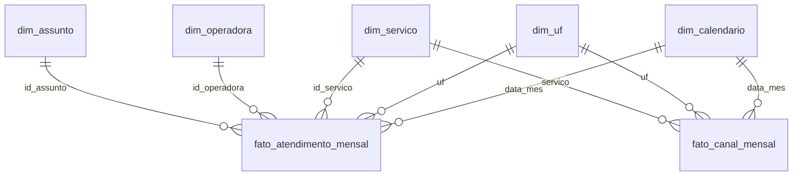

# Power BI

| Arquivo | O que é |
|---|---|
| `radar_atendimento.pbix` | Relatório Power BI (modelo estrela + medidas DAX) |
| `medidas.tmdl` | As 43 medidas DAX como código (aplicadas pela exibição TMDL do Power BI Desktop) |
| `tema_radar.json` | Tema do relatório, com as mesmas cores da lâmina HTML |
| `dados/*.parquet` | Modelo estrela gerado pelo pipeline (camada ouro) |

Os Parquet são regerados a cada execução do pipeline (`python pipeline/executar_pipeline.py`) e pela atualização automática mensal. Para atualizar o `.pbix`, abra-o e clique em **Atualizar**.

## Modelo

`dim_populacao` (chave UF + ano) não tem relacionamento: é consultada pela medida `População` com `LOOKUPVALUE`.

`fato_canal_mensal` vem de outra base da Anatel, já agrupada por grupo de operadora. Como esse grupo não é único na `dim_operadora`, não existe relacionamento físico: a medida `Solicitações por canal` aplica o filtro de operadora com `TREATAS` (relacionamento virtual).
